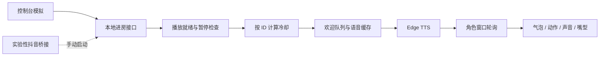

# 实现与接口

[返回 README](../README.md)

## 文件职责

| 文件 | 职责 |
| --- | --- |
| `app.py` | FastAPI、队列、语音缓存与播放窗口租约 |
| `welcome.py` | 线程安全冷却，使用可注入的单调时钟 |
| `web/index.html` | 模拟控制台、日志与暂停 |
| `web/overlay.js` | 渲染、事件轮询、播放与嘴型 |
| `connect_douyin.py` | 向本地服务提交连接请求的命令行入口 |
| `douyin_bridge.py` | 后台连接、消息计数和 2～30 秒断线重试 |
| `room_links.py` | 分享链接解析、跳转域名检查和观众身份提取 |
| `test_welcome.py` | 无网络冷却测试 |
| `verify-ui.cjs` | 使用 Edge 的浏览器验证 |

## 本地接口

无版本稳定承诺或用户认证，仅供本地开发。请求体为 JSON。

| 接口 | 说明 |
| --- | --- |
| `GET /api/status` | 模式、冷却、暂停、序号、播放器、日志、队列长度 |
| `POST /api/enter` | `{"uid":"demo-001","name":"小明"}`；返回 `accepted` 和文本或原因 |
| `POST /api/mute` | 切换暂停，不是幂等的设置接口 |
| `GET /api/events?after=0&client=...` | 获取增量事件并续约播放权；会影响状态，不适合作为监控接口 |

`accepted: true` 表示进入欢迎流程，不是音频完成的确认。

## 时序与容量

- 排队超过 25 秒的任务会在语音生成前后丢弃，避免积压后过时欢迎。
- 冷却在生成语音前记录；失败或未消费不会撤销冷却。
- 服务端待处理队列最多 20 条、事件环 40 条、日志环 80 条。
- 前端待播队列最多 20 条；约 45 秒前的事件跳过。拥堵可能丢失欢迎，尚无可靠重投与逐事件播放确认。
- 单个活动窗口持有约 5 秒租约，断开后其他窗口可接管。
- TTS 超时后尝试浏览器语音，不保证离线可用。暂停使旧代次事件失效。

## 验证边界

CI 验证冷却、分享链接解析和欢迎队列/播放租约规则。UI 测试会占用播放权并切换暂停，须在没有正在使用的角色页时运行。已有一次完整本地流程通过；同时打开用户角色窗口时，复测曾因播放权竞争而气泡等待超时。

抖音 WebSocket 与直播统计消息已实测；已有一次真实进房触发与浏览器播放回报通过；直播伴侣采集、长期高负载和干净系统安装尚未验证。增加证据后再更新项目状态。

## 连接管理

- `POST /api/connection/start`：`{"room":"分享链接或数字直播间号"}`，异步解析并连接，已有连接时拒绝重复启动。
- `POST /api/connection/stop`：断开连接，不关闭角色或本地服务。
- `/api/status` 中 `connection` 提供状态、房间号、消息/进房/接受/跳过计数与错误；只统计收到的进房消息，不等于平台全部进房人数。
- 状态包括解析、连接、已连接、重连、停止、结束与失败。窗口没有启用声音时，进房会计入跳过，不补播。
- 服务返回 `server_id`，角色页发现服务重启后重新同步事件序号，避免旧序号遮蔽新欢迎。

`POST /api/playback` 接收当前播放窗口对事件的 started/finished/failed 回报，`/api/status` 提供最近回报。数字 ID 字段兼容和无效 ID 过滤有回归测试。
